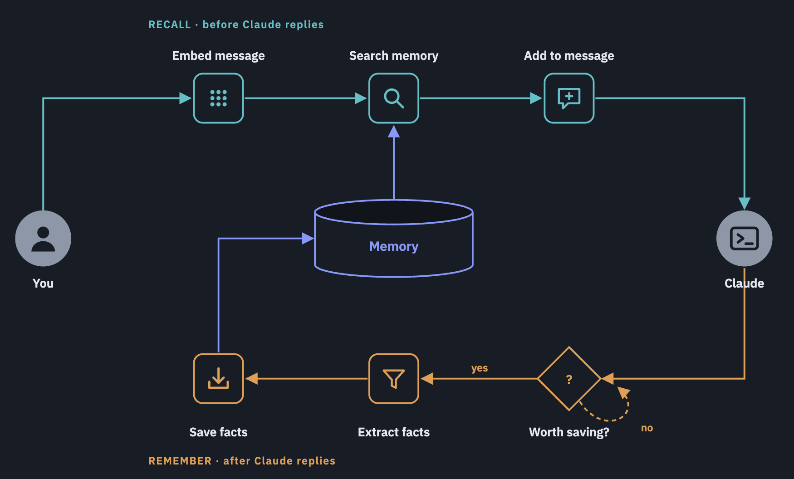

# memeng

Memory for engineering decisions in Claude Code. memeng captures each decision and its reason from the conversation, stores them in one SQLite file, and adds them back to your prompt when the subject comes up again.

Blog post: [Building a memory harness from scratch](https://lijames.substack.com/p/building-a-memory-harness-from-scratch)



## Why

Code shows what was built, not why. The reason for a choice usually lives in a chat thread, a pull request comment or one person's head, and it is lost within months. An engineer who finds a rule with no reason can either keep it without knowing why or remove it and find out the hard way.

memeng keeps a decision only if an engineer reading the code could not work it out alone. It saves the decision with the reason given in the conversation. When no reason is given, it saves nothing.

## How it works

memeng runs as two Claude Code hooks.

- **Capture (`Stop`).** After each reply, the hook starts a background process and returns right away. The process stores the new messages. A yes/no gate decides whether the window holds a decision with a reason. If it does, an extraction step pulls out the fact, its rationale, a category and the entities it mentions. Both steps call `claude -p --model sonnet` with all tools disabled.
- **Recall (`UserPromptSubmit`).** The hook embeds your prompt and scores stored facts by combining vector similarity, BM25 and entity matching. Facts below the relevance floor are dropped, and so are facts already shown in this session. The rest are added to your prompt as JSON. When nothing is relevant, nothing is added.

Facts are never updated or deleted. A newer fact can propose to supersede an older one. A person or an agent rules on the proposal, and both facts stay in the store. Recall makes no model call.

## Requirements

- Python 3.12 and [uv](https://docs.astral.sh/uv/)
- [Ollama](https://ollama.com), running at `http://localhost:11434`
- The `claude` command-line tool on your `PATH`

## Setup

Clone this repository, then run:

```bash
ollama pull embeddinggemma-2:270m
uv sync
uv run memeng setup
```

`memeng setup` does three things:

1. Creates the store at `~/.memeng/store.db`.
2. Writes `.memeng.toml` with a `project_id` at the git root. If you do not pass `--project-id` and the terminal is interactive, it lists the project IDs already in the store and asks you to pick one or type a new one. Without a choice, it uses the directory name.
3. Adds the two hooks to `.claude/settings.json` at the git root.

It also runs the checks that `memeng doctor` runs and prints their results. To run the checks again without changing anything:

```bash
uv run memeng doctor
```

### Use it in another repository

From inside the other repository, point `uv` at your memeng checkout:

```bash
uv run --project /abs/path/to/memeng memeng setup
```

`--project` keeps your current directory, so `.memeng.toml` and the hooks go into your repository. To set up a different directory instead, pass `--root <path>`.

### Where memeng is on

memeng runs only in a session whose working directory contains `.memeng.toml`. Start Claude Code from the directory where `setup` wrote it, which is the git root. Committing `.memeng.toml` does not turn memeng on, because each clone and worktree has to run `setup` to register the hooks. A worktree does not inherit the project of its main checkout.

To register the hooks for every session on the machine, run `memeng setup --settings ~/.claude/settings.json`. Each hook still does nothing outside directories with `.memeng.toml`, but every hook call starts a process, which adds a little time to each prompt and reply.

## Configuration

`~/.memeng/config.toml` overrides any field of `Config` in `src/memeng/config.py`. To read a different file, set `MEMENG_CONFIG` to its absolute path. The background capture process inherits the variable from the hook. If the named file does not exist, memeng raises an error instead of using the defaults.

| Field | Default | Meaning |
|---|---|---|
| `gate_model` | `sonnet` | Model for the yes/no gate |
| `extract_model` | `sonnet` | Model for extraction |
| `embed_model` | `embeddinggemma-2:270m` | Ollama embedding model. Run `memeng reembed` after you change it |
| `ollama_url` | `http://localhost:11434` | Ollama server |
| `db_path` | `~/.memeng/store.db` | SQLite store |
| `top_k` | `10` | Maximum number of facts added to a prompt |
| `semantic_threshold` | `0.74` | Relevance floor for recall |
| `conflict_threshold` | `0.6` | Cosine similarity above which two facts are flagged as a possible conflict |
| `window_token_cap` | `8000` | Number of conversation tokens the extractor sees |
| `record_decisions` | `true` | Whether to write the `logs_` tables |

The gate and extraction prompts are `src/memeng/prompts/gate.md` and `extract.md`. Edit them to change what counts as a decision.

## Commands

| Command | Purpose |
|---|---|
| `memeng setup` | Create the store, write `.memeng.toml` and register the hooks |
| `memeng doctor` | Check Ollama, the spaCy model, the store, `.memeng.toml` and the hooks |
| `memeng reembed [--force]` | Recompute every vector with the configured embedding model |
| `memeng judge <fact\|capture\|hit> <id> <verdict> [--note ...]` | Record whether a logged item was worth keeping |

## Library

The core does not depend on hooks or Claude Code:

```python
from pathlib import Path

from memeng import add, search, browse, dump, resolve
from memeng.config import Config
from memeng.database.utils import DB
from memeng.models.common import Scope

DB.open(Config.load())
scope = Scope(user_id="local", project_id="my-service")

search("where do we keep vectors and why", scope, explain=True)
browse(scope, category="architecture")
dump(scope, out_dir=Path("docs/decisions"))
resolve(supersession_id, status="retained", resolved_by="user")
```

`DB.open` sets up the configuration and the database connection once. No function takes either one as an argument.

## Decision logs

Four tables record what the hooks decided, so you can check a saved fact later. Capture and recall do not read them, so you can clear them safely.

| Table | One row per | Contents |
|---|---|---|
| `logs_captures` | Capture, saved or not | The window the model read, the raw gate reply and the outcome |
| `logs_retrieval` | Prompt that reached `search` | The prompt, `k` and which signals ran |
| `logs_retrieval_hits` | Ranked fact | Rank, the four score components and whether it was sent |
| `logs_verdicts` | Verdict | `noise` or `keep` for a fact, a capture or a hit |

`outcome` is one of `gate_no`, `nothing_extracted`, `all_duplicate`, `stored` or `failed`. `memories.capture_id` links a fact to the capture it came from.

Find facts that were never sent:

```sql
SELECT m.fact, count(h.id) AS times_sent, round(avg(h.final_score), 3) AS mean_score
FROM memories m
LEFT JOIN logs_retrieval_hits h ON h.memory_id = m.id AND h.injected = 1
GROUP BY m.id ORDER BY times_sent, mean_score;
```

Mark a fact as noise:

```bash
uv run memeng judge fact <memory id> noise --note "restates the ticket"
```

## Development

```bash
uv run pytest -q
```

The tests do not call Ollama or `claude`. To run the evaluations against real models, see [`evals/README.md`](evals/README.md).
